<p align="center">
  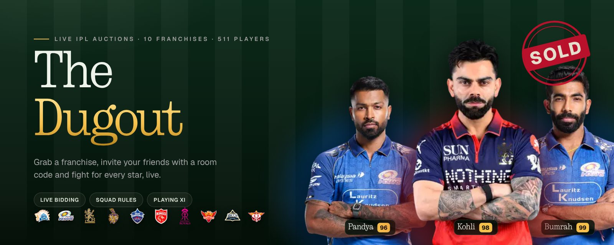
</p>

<p align="center">
  <strong>The Dugout: real-time, multiplayer IPL auctions with your friends.</strong><br />
  Create a room, share the code, pick a franchise and fight for every player live, then build and share your Playing XI.
</p>

<p align="center">
  <a href="https://ipl.sarvankumar.in"><strong>Play now: ipl.sarvankumar.in</strong></a><br />
  <sub>Also at <a href="https://ipl-auction-bbho.onrender.com">ipl-auction-bbho.onrender.com</a></sub>
</p>

<p align="center">
  
  
  
  
  
</p>

---

## Contents

- [Overview](#overview)
- [Screenshots](#screenshots)
- [Features](#features)
- [How a game works](#how-a-game-works)
- [Rules](#rules)
- [Player ratings](#player-ratings)
- [Getting started](#getting-started)
- [Deployment](#deployment)
- [Refreshing player data](#refreshing-player-data)
- [Project structure](#project-structure)
- [Credits](#credits)
- [Disclaimer](#disclaimer)

## Overview

The Dugout recreates the tension of the IPL auction table for a group of friends. One person hosts, everyone else joins with a five-letter room code, and each player takes one of the ten franchises. Players come up in sets, the clock resets on every bid, and the hammer falls when the clock runs out. Empty franchises can be handed to computer players, so a full ten-team auction works even with two people.

When the auction ends, every owner arranges a Playing XI on a cricket ground, gets suggestions to improve it, locks it in and shares the result as an image.

## Screenshots

<table>
  <tr>
    <td width="50%">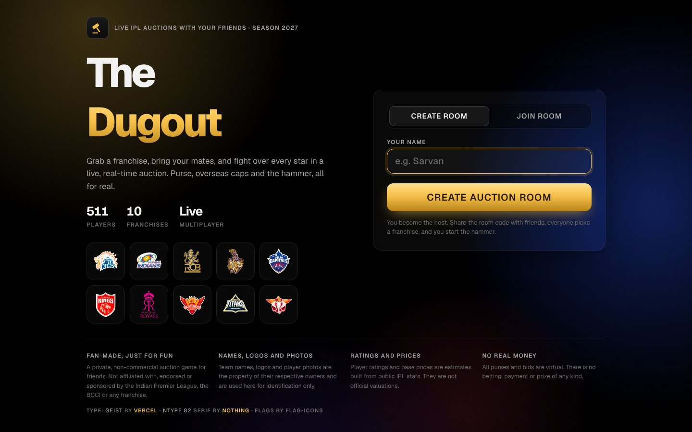<br /><sub><b>Home.</b> Create a room or join one with a code.</sub></td>
    <td width="50%">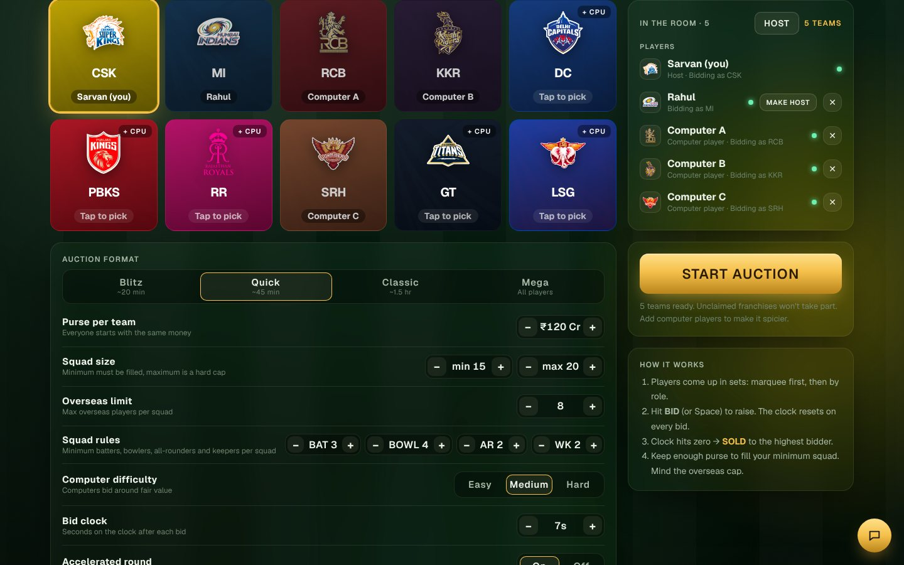<br /><sub><b>Lobby.</b> Pick a franchise, add computer players, set the format and squad rules.</sub></td>
  </tr>
  <tr>
    <td width="50%">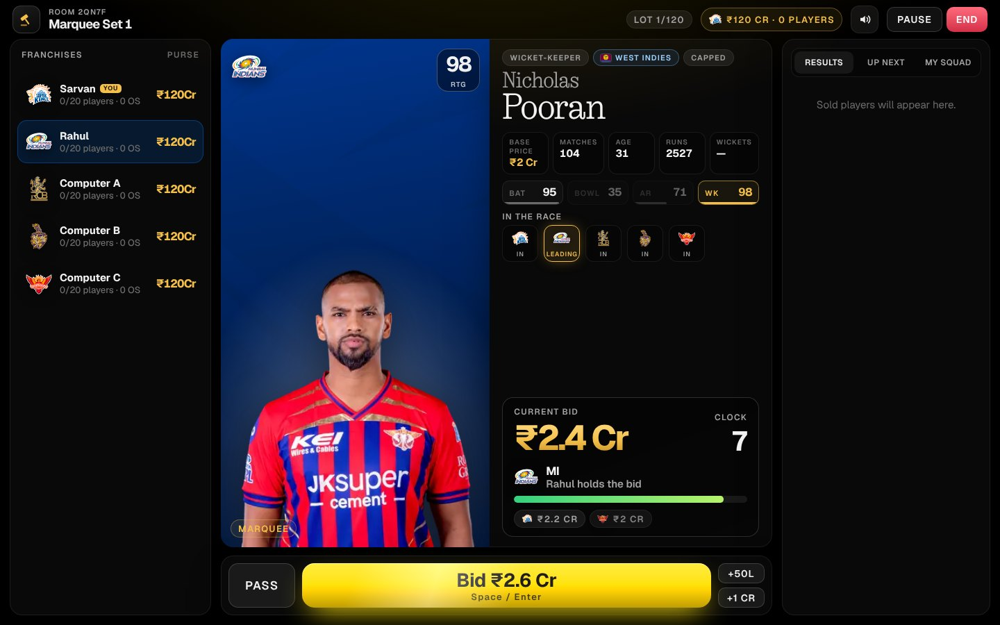<br /><sub><b>Live auction.</b> Player card with stats and role ratings, live bid, clock and teams still in the race.</sub></td>
    <td width="50%">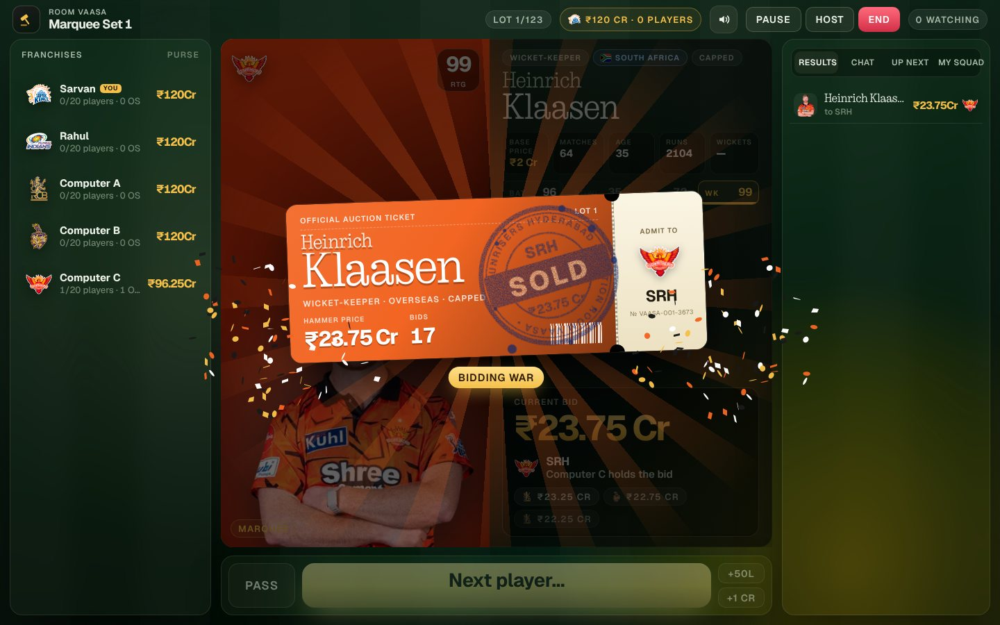<br /><sub><b>The hammer.</b> Gavel, auction ticket and an ink-stamped SOLD.</sub></td>
  </tr>
  <tr>
    <td width="50%">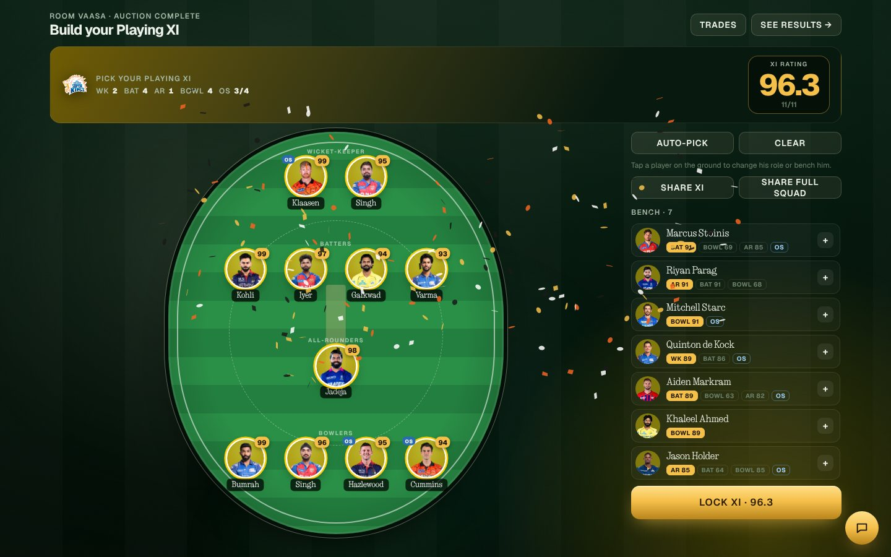<br /><sub><b>Playing XI.</b> Arrange your side on the ground, switch roles, auto-pick or follow suggestions.</sub></td>
    <td width="50%">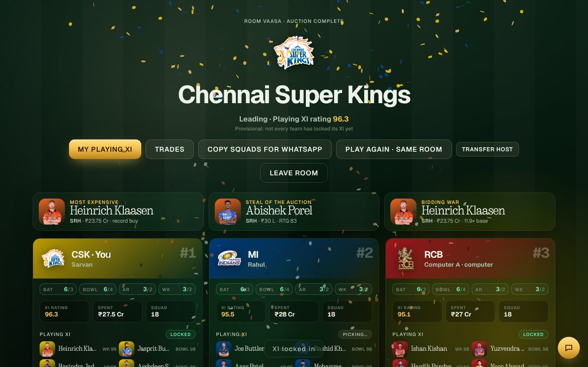<br /><sub><b>Results.</b> Teams ranked by Playing XI rating, with awards and squad rules.</sub></td>
  </tr>
</table>

<table>
  <tr>
    <td width="25%">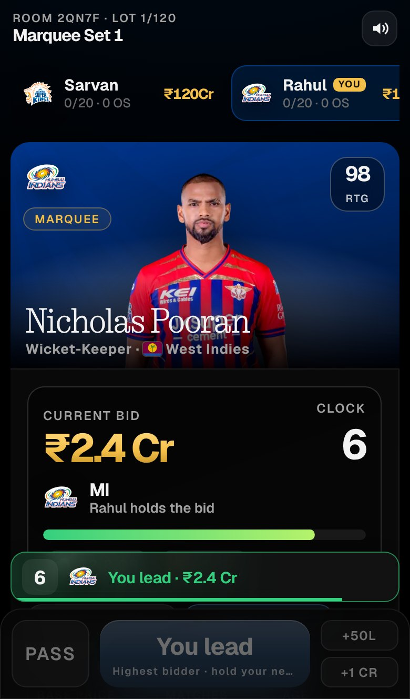<br /><sub><b>Phone.</b> Live bid bar above the Bid button.</sub></td>
    <td width="25%">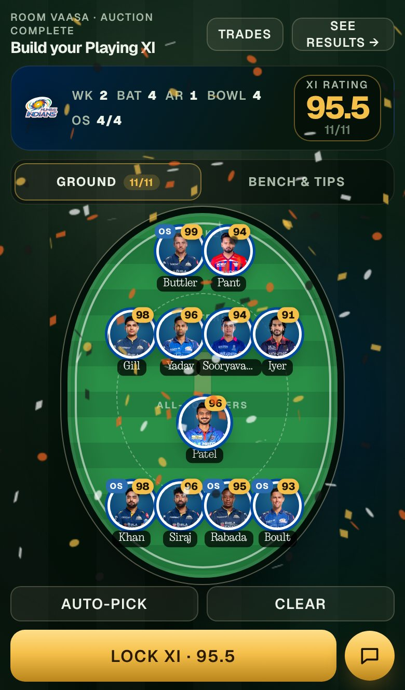<br /><sub><b>Phone.</b> Playing XI on the ground.</sub></td>
    <td width="25%">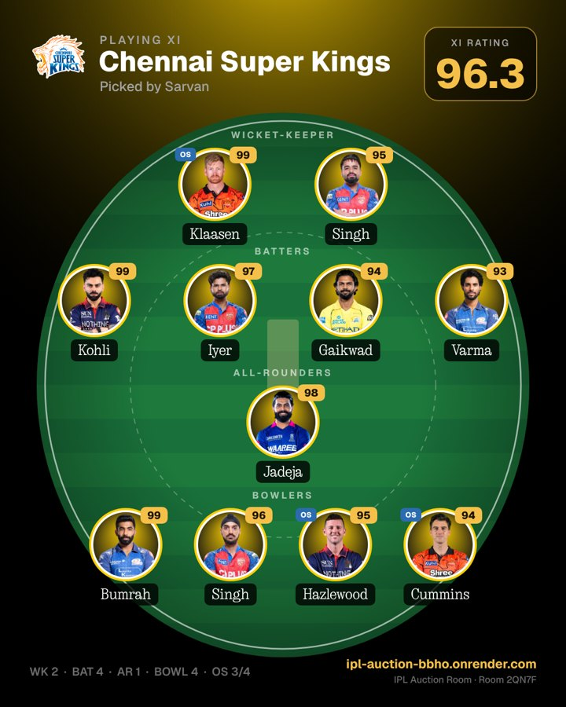<br /><sub><b>Share card.</b> Your Playing XI as an image.</sub></td>
    <td width="25%">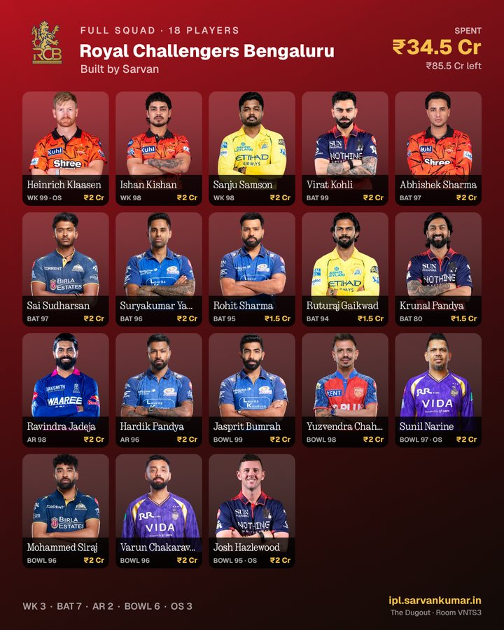<br /><sub><b>Share card.</b> Your full squad as an image.</sub></td>
  </tr>
</table>

## Features

**Rooms and players**
- Five-letter room codes and invite links; works on phones, tablets and laptops.
- All ten franchises with their names, colours and logos.
- Computer players (Computer A, Computer B and so on) fill any empty franchise and bid sensibly for the roles they need.
- Room chat: text chat in the lobby, during the auction and on the results screen, with quick replies, unread badges and spam protection.
- Optional trading window after the auction (host toggles it in room settings): offer players and cash to any team, the other owner accepts or declines, and computer teams answer instantly based on how the deal changes their XI.
- Up to 10 spectators per room on top of the 10 team owners. Spectators send emoji reactions that float over the stage, limited per person and per room so they never flood the screen.
- The host can hand over host controls to anyone in the room, in the lobby, mid-auction or on the results screen.
- Refreshing or dropping connection puts you straight back in your seat. Leaving a lobby frees your franchise; if the host leaves, hosting passes on.

**The auction**
- 511 players from every IPL squad between 2021 and 2026, 460 with official cut-out photos.
- Marquee sets first, then capped and uncapped sets by role, plus an optional accelerated round for unsold players.
- A seven-second clock that resets on every bid; Pass to drop out of a lot early.
- Jump bids (+50 L, +1 Cr), keyboard shortcuts (Space or Enter to bid, P to pass).
- Live race strip showing who is leading, who passed and who can no longer afford the player.
- A sold ceremony: gavel, auction ticket, ink-textured stamp, light rays and crowd sound, with tags for record buys, steals and bidding wars.
- On phones, a live bar above the Bid button flashes on every rival bid and turns red when you are outbid.
- Works in portrait and landscape on phones, with a compact layout for short laptop screens.

**After the auction**
- Playing XI builder on a top-down cricket ground with player heads by role and an animated XI rating.
- Auto-pick, one-tap swap suggestions with the rating gain, role switching and a bench.
- Lock your XI; computer teams lock theirs automatically and the final standings rank teams by XI rating.
- Share your Playing XI or your full squad as a 1080 x 1350 image, ready for Instagram or WhatsApp.
- Copy every squad as text for a group chat, and play again in the same room with the same friends.

**Sharing and install**
- Rich link previews: the site shares with a designed 1200 x 630 card, and room links preview as a personal invite ("Sarvan invited you to an IPL auction on The Dugout") with live franchise count.
- Installable on phones: add to the home screen for a full-screen app with its own icon.

## How a game works

1. **Create a room.** The host enters a name and creates a room. The room code appears at the top of the lobby.
2. **Invite friends.** Share the code or the invite link. Everyone picks a franchise; the host can fill the rest with computer players.
3. **Choose a format.** Blitz (about 20 minutes), Quick (about 45), Classic (about 90) or Mega (all players). The host can also change the purse, squad size, overseas limit, bid clock, squad rules and how tough the computer players are.
4. **Bid.** Players come up one by one. Bid, jump bid or pass. When the clock runs out, the highest bidder wins the player.
5. **Pick your Playing XI.** Arrange eleven players on the ground, follow the suggestions or auto-pick, then lock it in.
6. **Compare and share.** The results screen ranks every team, highlights the biggest buys, and lets you share your XI or squad.

## Rules

| Rule | Default | Notes |
|------|---------|-------|
| Purse | ₹120 Cr | Adjustable by the host. |
| Squad size | 15 to 20 | Depends on the format; the maximum is a hard cap. |
| Overseas players | 8 per squad, 4 in the Playing XI | Hard caps. |
| Squad rules | 3 batters, 4 bowlers, 2 all-rounders, 2 wicket-keepers | Adjustable. The server blocks any bid that would make them impossible to meet. |
| Purse reserve | 30 L per player you still have to buy | You can't spend money needed to complete your squad. The Bid button says how much to keep and why. |
| Bid increments | 5 L below 1 Cr, 10 L to 2 Cr, 20 L to 5 Cr, 25 L to 10 Cr, 50 L above | Jump bids are limited to +5 Cr. |
| Bid clock | 7 seconds | The first bid on each player gets 3 extra seconds. |
| Computer difficulty | Medium | Easy: computers drop out early and often let you have players cheaply. Medium: they bid around fair value. Hard: they pay big, contest your bids and react faster. |
| Playing XI | 11 players, at least 1 keeper and 5 bowling options | Missing keeper or bowling options lowers the XI rating. |

## Player ratings

Every player has four ratings, one for each role. They are built from IPL statistics on iplt20.com, with the most recent two seasons weighted most heavily.

| Rating | Built from |
|--------|-----------|
| Batting | Runs, strike rate and average |
| Bowling | Wickets, economy and bowling strike rate |
| All-rounder | A blend of batting and bowling, rewarded when a player is strong at both |
| Wicket-keeping | Batting plus a small bonus for catches and stumpings (keepers only) |

The headline rating is the player's main role. The best 62 players are spread evenly between 90 and 99, and everyone else is capped at 89. Marquee and retained players receive a small boost. Owners can move a bought player into any role he is eligible for, and his rating follows that role.

Manual adjustments live in `RATING_OVERRIDE` in `scripts/ratings.mjs` (currently Hardik Pandya 96 and Andre Russell 95).

## Getting started

Requirements: Node.js 20 or newer.

```bash
git clone https://github.com/sarvan-2187/ipl-auction-simulator.git
cd ipl-auction-simulator
npm install        # installs the server and the client
npm run build      # builds the client
npm start          # http://localhost:3001
```

Friends on the same Wi-Fi can join at `http://<your-computer-ip>:3001`.

For development with hot reload:

```bash
npm run dev        # client on http://localhost:5173, server on :3001
npm test           # auction engine, squad rules and Playing XI tests
```

## Deployment

The server keeps rooms in memory and needs a host that runs a long-lived Node process with WebSockets. Serverless platforms such as Vercel are not suitable.

**Render (recommended).** The repository includes a `render.yaml` blueprint.

1. Sign in to Render with GitHub.
2. Choose **New, Blueprint** and select this repository.
3. Apply. The first build takes a few minutes.

On the free plan the service sleeps after about 15 minutes without traffic. The game pings the server every few minutes while you are in a room, and `GET /api/health` can be used with an uptime monitor such as UptimeRobot to keep it awake. A restart or redeploy ends any auction in progress.

`GET /api/health` returns:

```json
{ "status": "ok", "service": "ipl-auction", "uptimeSeconds": 5321, "rooms": 1, "liveAuctions": 1, "playersOnline": 4, "version": "1a46efe", "time": "..." }
```

## Refreshing player data

```bash
npm run fetch-data              # re-download squads, retentions, stats, photos and logos
npm run fetch-data -- --force   # also re-download every image
npm run rerate                  # recalculate ratings offline from cached stats (no downloads)
```

`fetch-data` reads the public squad pages and player statistics on iplt20.com for seasons 2021 to 2026, plus the IPL 2027 retention list, which is used for capped status, age and a small rating boost. Statistics are cached in `scripts/.cache`, so `rerate` can rebuild every rating in under a second.

## Project structure

```
server/
  index.js            Express and Socket.IO server, rooms, reconnects, health endpoint
  game.js             Auction engine: sets, bidding, clock, squad rules, computer players
  xi.js               Playing XI rating, validation and auto-pick
  game.test.js        Engine tests, including a full computer-only auction
client/src/
  screens/            Home, Lobby, Auction, Results
  components/         Sold ceremony, Playing XI builder, squad drawer, squad rules
  lib/                Data, sockets, sounds, Playing XI logic, share-card renderer
client/public/
  players/            Player photos
  teams/              Franchise logos and patterns
  fonts/              Geist and NType 82, with credits
  flags/              Country flags
scripts/
  fetch-data.mjs      Squad, stats and photo scraper
  ratings.mjs         Rating engine shared by fetch-data and rerate
  rerate.mjs          Offline rating rebuild
docs/images/          README banner and screenshots
```

## Credits

- **Typography:** [Geist](https://vercel.com/font) by Vercel (SIL Open Font License) for the interface, and NType 82 by [Nothing](https://nothing.tech) for player names. Font files and licences are in `client/public/fonts`.
- **Emoji:** [Microsoft Fluent Emoji](https://github.com/microsoft/fluentui-emoji) 3D images (MIT) for spectator reactions.
- **Flags:** [flag-icons](https://github.com/lipis/flag-icons) by Panayiotis Lipiridis (MIT). The West Indies flag is a custom drawing.
- **Data:** squads, statistics and player photos from the public pages of [iplt20.com](https://www.iplt20.com).
- **Built with:** React, Vite, Framer Motion, Express and Socket.IO.

## Disclaimer

- **Fan-made and non-commercial.** This is a private game made for friends. It is not affiliated with, endorsed by or sponsored by the Indian Premier League, the Board of Control for Cricket in India or any IPL franchise.
- **Names, logos and photos.** Team names, logos, player names and player photos are the property of their respective owners and are used here for identification only. No ownership is claimed.
- **Ratings and prices.** Player ratings, base prices and computer bidding are estimates derived from public statistics. They are not official valuations and say nothing about any player's real auction value.
- **No real money.** All purses, bids and prices are virtual. The game involves no betting, payments or prizes of any kind.
- **Fonts.** NType 82 is a proprietary typeface by Nothing and is used only in this private, non-commercial project.
- **Takedown.** If you own any of the material used here and would like it removed, please open an issue and it will be taken down.

## Analytics

Built-in, cookie-free counters (visits, create/join/install clicks, rooms created, auctions started and finished) plus a live view of open rooms and players online. No personal data is stored.

Set `ANALYTICS_KEY` on the server to a long random string, then open `/admin/stats` and enter the key. Without the variable the dashboard stays off. History is written to a JSON file in the temp folder; set `DATA_DIR` to a persistent disk to keep it across restarts and deploys.
